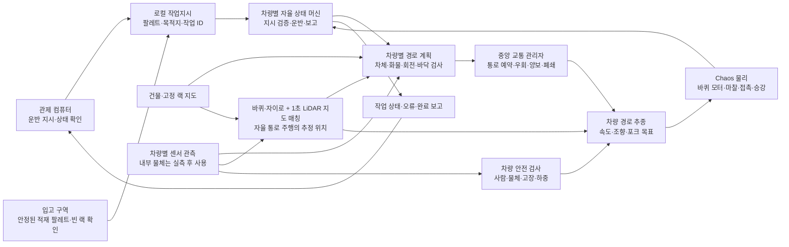
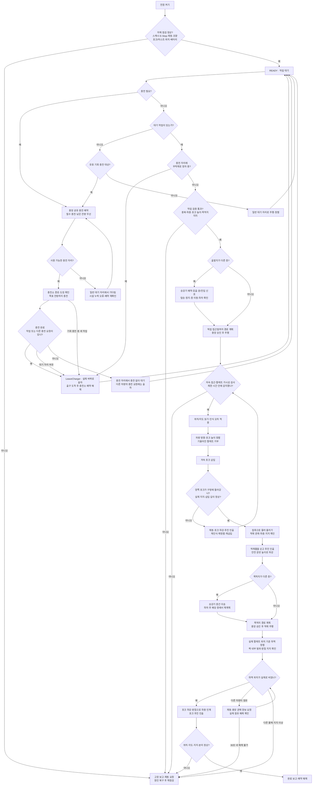
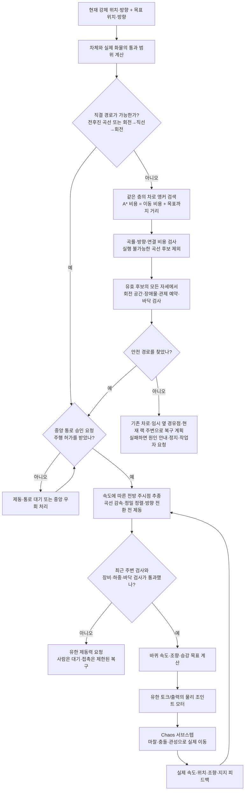
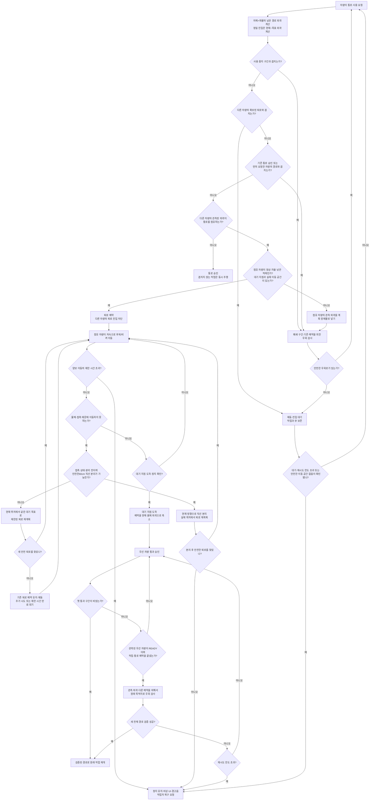

# 지게차 이동 알고리즘과 실제 관제 시스템 비교

도식 정리 기준은 **2026-10-20**, 위치 추정 연결은 **2026-10-31**에 갱신했다. 현재 맵에서 실행되는 `WarehouseForklift`와 `WarehouseFleetCoordinator`의 코드를 읽어 도식화했다. 아래의 실제 시스템 설명은 제조사·표준 작성자·Open-RMF의 공개 자료에 근거하며, 비공개 제조사 알고리즘까지 같다고 가정하지 않는다. 센서·추정 위치 통합의 진행 상태·정보 경계·실행 검사와 운반 시간의 확인 범위는 [AUTONOMY.md](AUTONOMY.md), 물리 계수·실측 전 가정은 [PHYSICS.md](PHYSICS.md)를 따른다.

## 1. 전체 담당 관계

현재 중앙 교통 시스템은 게임 안에서 실행되는 단일 관제 관리자다. 작업 배정은 관제 컴퓨터·입고 구역이 담당하고, 통로 승인은 중앙 교통 관리자가 담당한다. 차량마다 자체 상태 머신·경로 계획·안전 검사·물리 구동을 수행한다.

차량 AI와 중앙 교통 관리자가 별도 위치에 있어도, 현재 둘은 같은 게임 프로세스의 객체 호출로 연결된다. 실제 WMS/MES 서버, MQTT 브로커, 네트워크 지연·통신 끊김 처리는 아직 연결되어 있지 않다. `Source/msc_vr/Agv/`의 LiDAR 센서와 위치 추정을 기존 경로 추종에 선별 연결하며, 독립 내비게이터·타이어 구동·안전 모듈은 분리한다. 정밀 접근·추정 상실·지도 변경 경계는 [AUTONOMY.md](AUTONOMY.md)의 추정 위치 주행 통합 절을 따른다. 원격 조작은 센서·AI·위치 추정을 거치지 않고 기존 물리 구동에 입력한다.

## 2. 차량의 작업 상태 흐름

충전소·일반 대기는 [AUTONOMY.md](AUTONOMY.md)의 공유 운영 정책을 따른다. 시설 존재 여부도 작업 검증에 포함한다. 충전기에 정차한 차량은 지시를 보존한 채 `LeaveCharger`로 출차하고 READY에서 작업을 수락한다. 충전 검증의 실제 범위는 [PHYSICS.md](PHYSICS.md)에 기록한다.

삽입 재시도는 무한 반복하지 않는다. 재시도 한도를 넘거나 적재물 지지 상실·과적·전도·장비 고장이 확인되면 정지와 작업자 복구 요청으로 끝낸다. 팔레트·상자는 운반 중에도 동적 강체이며, 차체에 붙이거나 충돌을 꺼서 운반 성공을 만들지 않는다. 승강기 상태·상호 잠금의 상세 담당은 [MEZZANINE.md](MEZZANINE.md)다.

## 3. 경로 계산과 실제 이동

계획은 같은 층의 차로 앵커 후보를 최대40개까지 사용한다. 복구 때 추가한 임시 경유점도 이 후보에 포함되며, 현재 위치·목표·방향 보정 노드는 따로 추가한다. 복구 계획에서는 사전 지도에 게시된 고정 랙과 관측 물체의 저장 외곽 주변에서도 경유점을 생성한다. 출발·목표와 가까운 후보부터 최대192개를 검사해 최대48개를 추가하며, 모든 연결은 차량·적재물의 이동·회전 범위와 고정 지도·센서 관측·바닥 지지 검사를 통과해야 한다. 이 후보는 저장 맵에 쓰지 않고 복구 계획마다 다시 계산한다. 임의의 창고 전체를 자유 공간 탐색으로 항상 풀어내는 계획기는 아니다. 적재 중에는 차량에 실린 화물의 실제 돌출 범위를 더하고, 자리 회전은 앞쪽 하중 바퀴 사이를 중심으로 전체 차체·화물의 회전 공간을 검사한다. 경로 추종이 요청한 속도와 실제 속도는 서로 다르며, 실제 바퀴 접촉·모터·부하 때문에 목표 속도에 즉시 도달하지 않는다.

주변 사람·장애물 관측은 **시뮬레이션 시간1초마다** 갱신하고 사이에는 최근 관측을 사용한다. 실제 Chaos 충돌과 물리 서브스텝은 계속 작동한다. `SeePallet`은 같은 스캔에서 관측되고 거리·시야각·가시선을 통과한 팔레트의 저장된 모델 인식 결과를 반환한다. 모델 자세에 인식 오차를 더하는 근사이며, 점군에서 팔레트 형상·구멍을 추출하는 실제 영상/LiDAR 알고리즘은 아니다. 자체 점검의 센서 정상 여부도 교육용으로 주입하는 값이다.

현재 성능 최적화는 이 센서 주기를 줄이거나 물리를 생략하지 않는다. 주기적 재고·입고 조회는 하중 시스템의 최신 받침 스냅샷을 공유하고, 경로는 실행 불가능하거나 최선 비용을 개선할 수 없는 곡선 후보를 먼저 제외한다. 선택 가능한 후보의 모든 자세는 고정 지도와 현재 사용할 수 있는 관측으로 검사한다. 센서 수집과 각 판단의 소비 시점을 분리하며 새 경로·방향·관측에 맞게 다시 판단한다. 센서 측정은 [AUTONOMY.md](AUTONOMY.md), 하중·경로 최적화와 CPU/GPU 측정은 [PHYSICS.md](PHYSICS.md)를 따른다.

## 4. 중앙 교통 관리의 의사결정

이미 진입 승인받은 차량을 우선하고 신규 충돌 요청은 요청 순서로 대기한다. 예약은 남은 경로의 공간 외곽을 비교하는 방식이며, 모든 차량의 미래 도착시각을 동시에 최적화하는 시간표는 아니다. 긴 경로 전체의 예약은 충돌 예방을 쉽게 하지만 겹치는 길을 오래 묶어 처리량을 낮출 수 있다.

퇴로는 뒤쪽 후보를 먼저 검사하고 앞쪽·옆쪽 후보도 검사한다. 차량·화물이 통과할 실제 공간, 바닥 지지, 다른 예약을 확인한 후 유한 구동력으로 이동한다. 양보 도중 접촉·장애물이 생기면 같은 대기 목표로 제한된 재계획을 수행하며, 접촉 분리 이동도 검사를 통과한 방향만 사용한다. 사람이 있는 방향으로 자동 탈출하지 않는다. 세부 한도와 실행 검증은 [AUTONOMY.md](AUTONOMY.md)의 중앙 관제·끼임 복구 절을 따른다.

## 5. 실제 시스템과의 비교

비교 자료의 범위는 서로 다르다. VisionNav는 실제 제조사의 공개 운용 사례이며, VDA5050은 관제↔차량 통신 규격이고, Open-RMF는 공개된 다중 로봇 교통 조정 구현이다. 이 셋을 하나의 특정 공장 시스템이나 동일한 제조사 내부 알고리즘으로 묶지 않는다.

| 항목 | 현재 게임 | 실제 공개 시스템/규격 | 차이가 시뮬레이션에 주는 의미 |
| --- | --- | --- | --- |
| 작업과 관제 분담 | 로컬 컴퓨터/입고 구역이 지시하고 차량 상태 머신이 실행·보고 | VisionNav 사례는 WMS→중앙 관제→차량 운반이며 RCS는 차량·작업·이상·실시간 경로를 관리한다. [제조사 운용 사례](https://www.visionnav.com/application/vnsl14productionlinemanufacturingindustry), [RCS](https://www.visionnav.com/product/robot-control-system.php) | 작업 단계와 병목 위치는 비교할 수 있다. 실제 IT 연동 시간은 포함되지 않는다. |
| 관제 통신 | 같은 프로세스의 함수·이벤트, 작업 큐 | VDA5050은 MQTT/JSON의 지시·상태·접속·차량 정보 교환을 정의한다. [공식 명세4·5절](https://github.com/VDA5050/VDA5050/blob/main/VDA5050_EN.md#4-transport-protocol) | 무선 지연·손실·끊김·재접속은 아직 시험할 수 없다. |
| 위치와 팔레트 인식 | 바퀴/자이로 오도메트리와 공통1초 LiDAR 스냅샷의 지도 매칭을 기존 경로 추종에 연결. 관측 후 팔레트 모델 자세와 오차 주입 | VisionNav VNSL14 공개 사례는3D laser SLAM과3D 센서 기반 팔레트 자세·포크 구멍 인식을 설명한다. [제조사 사례](https://www.visionnav.com/application/vnsl14productionlinemanufacturingindustry) | 완전한3D SLAM이나 영상/점군 기반 팔레트 ML 인식기는 아니다. 정밀 접근은 기존 정확한 자세를 유지한다. |
| 경로 계획 | 차량별 차로 앵커 A*와 곡선/자리 회전 연결 | VDA5050은 선로 추종과 차량 자체 계획을 구분하지만 특정 계획 알고리즘을 지정하지 않는다. [공식 명세2·3·5절](https://github.com/VDA5050/VDA5050/blob/main/VDA5050_EN.md#2-scope) | 현재 A*가 제조사와 동일하거나 표준이 요구하는 알고리즘이라고 말할 수 없다. |
| 교통 승인 | 남은 경로 외곽 예약, 진입 차량 우선·신규 요청 순서 | VDA5050의 실행 허가와 요청/응답은 승인 교환을 표현한다. Open-RMF는 시간 정보를 가진 궤적·계획을 제안·거절·대안 협상한다. [VDA5050 6.9절](https://github.com/VDA5050/VDA5050/blob/main/VDA5050_EN.md#69-requestresponse-mechanism), [RMF 협상 코드](https://github.com/open-rmf/rmf_traffic/blob/main/rmf_traffic/include/rmf_traffic/schedule/Negotiation.hpp), [RMF 궤적 코드](https://github.com/open-rmf/rmf_traffic/blob/main/rmf_traffic/include/rmf_traffic/Trajectory.hpp) | 현재 예약은 시간 슬롯 최적화·도착시각 기반 협상보다 보수적이며 처리량이 달라질 수 있다. |
| 정체와 복구 | 우회·퇴로 확보·실제 후퇴·접촉 분리·재개·안전 공간 없으면 작업자 요청 | VDA5050은 관제의 막힘 해소 역할과 실행 허가 상실 시 대응을 설명하되, 상세 교통 해법은 범위 밖이다. [공식 명세5.3·6.6.10절](https://github.com/VDA5050/VDA5050/blob/main/VDA5050_EN.md#53-functions-of-the-fleet-control) | 이 게임의60cm 분리·후퇴 후보·횟수 제한은 프로젝트 구현이며 제조사 복구 절차로 일반화하지 않는다. |
| 안전 정지 | 주기적 주변 검사·고장 플래그·유한 제동·Chaos 충돌 | VDA5050은 안전 표준이 아니며 기능·운영·시스템 안전 요구를 정의하지 않는다고 명시한다. [공식 명세2절](https://github.com/VDA5050/VDA5050/blob/main/VDA5050_EN.md#2-scope) | 현재1초 검사를 실제 안전 스캐너 응답이나 안전 인증에 해당한다고 취급하지 않는다. |
| 차량 물리 | 질량·마찰·모터·제동·하중·지지에 따른 강체 거동 | 실제 차량의 모터·타이어·바닥·부하 특성은 실측과 제조사 데이터로 확인해야 한다. 게임의 검증·가정은 [PHYSICS.md](PHYSICS.md) | 배치별 상대 효율 비교에 사용하며 실제 처리량 예측의 정확도는 실측 보정 수준에 달린다. |

**현재 비교 가능한 대상은 배치·동선·작업 순서에 따른 상대적인 대기와 처리 시간이다.** 센서·통신·안전 장치의 현실성을 추가하려면 실제 장비 데이터로 지연·오차·제동·구동·하중을 보정해야 한다. 제조사 비공개 관제 알고리즘을 재현했다고 주장하지 않는다.

## 6. 다시 확인할 코드

| 확인할 알고리즘 | 진입점 |
| --- | --- |
| 작업 수신·상태 전환·완료 보고 | `WarehouseForkliftAI.cpp`의 `SubmitJob`, `AdvanceAutonomy`, `ReportJob` |
| 경로의 공간·곡률·앵커 탐색 | 같은 파일의 `NavigationEnvelope`, `NavigationClear`, `ConnectPoses`, `ConnectLanePoses`, `PlanAutonomousRoute` |
| 경로 추종·실제 팔레트 감지 | 같은 파일의 `FollowRoute`, `SeePallet`, `RackLoadAligned` |
| 통로 승인·점유 차량 양보·접촉 분리·재개 | `WarehouseFleetCoordinator.cpp`의 `Permit`, `Retreat`, `AdvanceYield`, `PlanningClear` |
| 삽입 재시도·일반 접촉 후진·우회 | `WarehouseForkliftRecovery.cpp`의 `BeginRecovery`, `AdvanceRecovery`, `PlanRecoveryDetour` |
| 바퀴·조향·브레이크·승강 물리 제어 | `WarehouseForkliftPhysics.cpp`의 `CommandDrive`, `CommandTurn`, `UpdatePhysicalRig` |

VDA5050 공식 저장소는 확인 당시3.0.0을 공개하고 있으며, 저장소의 Markdown과 공식 PDF가 다르면 VDA가 게시한 PDF가 우선한다고 안내한다. 표의 프로토콜 비교는 공개 명세와 개념의 비교이며, 게임이 VDA5050을 구현하거나 적합성 검사를 통과했다는 뜻은 아니다. [VDA5050 공식 저장소](https://github.com/VDA5050/VDA5050)
