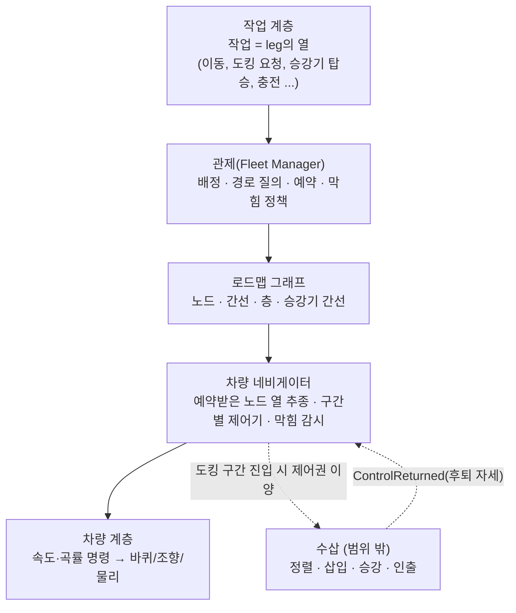

# 지게차 내비게이션 재설계안 (초안)

작성 기준일: **2026-10-21**. **설계 문서이며 구현되지 않았다.** 현재 구현은 [AUTONOMY.md](../../../AUTONOMY.md)(메인 지게차)와 [FORKLIFT_NAVIGATION.md](FORKLIFT_NAVIGATION.md)(별도 AGV 모듈)를 따른다. 포크 삽입·승강(수삽)은 이 설계의 범위가 아니며 경계만 정한다.

## 1. 왜 다시 설계하는가 (2026-10-20~21 실측)

| 관찰 | 근거 |
| --- | --- |
| 이동 시간의 대부분이 정지 | 1호 차 24 m 픽업 이동 113.5초 중 이동 30 %. 이후 개선해 41.0초(피벗 4 → 3개, 90° 회전 10~13초 → 5초) |
| 같은 종류의 문제가 장소만 바꿔 반복 | 정렬 17초 앞뒤 흔들림, 중간 코너 정지·접근 순환, 적재 운반 중 한 자리에서 120초 이상 제자리 회전 반전 76회 (`two_jobs.py`) |
| 경로 계획 실패 = 작업 고장 | 통로 막힘, 충전기 출차, 레이아웃 변경 등 고장으로 끝나는 분기가 여러 곳 |
| 회귀를 판정할 기준선이 없음 | 기존 시험 14종 중 7종이 원본 코드에서도 실패. 수정 후 "내 수정 때문인가"를 매번 새로 가려야 했음 |
| 다층 작업의 받침이 없음 | 앵커는 차량별·한 층용이고 승강기는 차량 상태 머신의 하위 절차 |

원인은 한 줄이 아니라 구조다.
1. 제어 단계마다 성공 조건(위치 5 cm, 방향 1°, 속도 1 cm/s 미만, 회전 0.5°/s 미만)이 동시에 걸리고, 충돌하면 빠져나오는 장치가 없다.
2. 계획기는 "회전→직진→회전" 같은 경로를 만들지만 제어기는 그것을 정밀하게 못 맞춘다.
3. 차량별 계획에 다른 차량의 통로 예약이 섞여, "일시적으로 막힘"과 "길이 없음"이 구분되지 않는다.
4. 합격 기준이 있는 시나리오 시험이 없다.

## 2. 목표와 합격 기준

| 항목 | 기준 (초안, 기준선은 2026-10-21 측정값) |
| --- | --- |
| 정속 주행 비율 | 경로 길이 대비 이동 시간이 `길이 / 정격 속도 + 코너 시간 합 + 예약 대기`의 1.3배 이내 (현재 24 m: 약 41초 vs 이상치 약 14초 + 코너 3개) |
| 코너 | 반경 ≥ 117 cm가 확보되면 정지 없이 호로 통과. 제자리 회전은 공간이 없을 때만 |
| 도리도리 | 한 작업에서 전후진 전환 ≤ 6회, 한 지점 정체 ≤ 10초 (정지 사유가 예약 대기인 경우 제외) |
| 완료율 | 시나리오 전체에서 작업 완료, 고장 0 (의도된 고장 시나리오 제외) |
| 계획 지연 | 한 번의 경로 질의 ≤ 50 ms (현재는 후보 노드와 충돌 질의를 반복해 수백 ms~수 초) |
| 결정성 | 같은 시나리오·같은 코드는 같은 결과 (현재 시뮬레이션은 이미 결정적) |

## 3. 계층 구조

원칙: 위 층은 아래 층의 내부를 모른다. 차량 계층만 바퀴 구성을 안다 (본인이 2026-09-30에 정한 원칙).

## 4. 로드맵 그래프

- **노드:** `Id`, `Floor`, `위치`, `종류`(차로·교차점·도킹 접근점·대기 자리·**교행 자리**·충전기·승강기 문 앞·승강기 내부).
- **간선:** `길이`, `양방향 여부`, `수용 대수`(1 = 단일 차로), `속도 제한`, `허용 방향(전진/후진)`, `폭`.
- **승강기 간선:** 층 A의 승강기 문 앞 노드 → 층 B의 승강기 문 앞 노드. 간선 비용 = 호출 + 이동 시간 + 대기 기댓값. 승강기는 **예약 가능한 자원**이다.
- **생성:** 현재 `NavigationAnchors`와 `AgvRouteNode`를 변환한다. 랙 위치에서 도킹 접근점(팔레트 앞 220 cm)을 자동 생성한다. 배치 편집이 끝나면 그래프를 갱신한다 (`RefreshAfterLayout`와 같은 시점).
- **검증:** 그래프를 만들 때 차체 외곽을 간선 위로 쓸어 보아 통과 가능한 간선만 남기고, 연결되지 않은 노드는 목록으로 보고한다 (런타임의 "경로 없음 고장"을 시작 시점의 정적 진단으로 앞당긴다).

## 5. 관제 (Fleet Manager)

| 책임 | 내용 |
| --- | --- |
| 배정 | 작업 → 가용 차량. 비용 = 접근 시간 + 예약 대기 기댓값 + 배터리 |
| 경로 질의 | 다익스트라. 간선 비용에 시간(피벗·후진 포함)과 혼잡을 반영. 정적 막힘(닫힌 구간)만 제외 |
| 예약 | 노드·간선 점유 구간을 선착순 + 우선순위로 예약. 단일 차로 간선은 방향 잠금. 교행 자리를 경유해 맞은편 차량을 비켜 줌 |
| 막힘 정책 | 아래 표 |

| 사유 | 기본 동작 | 비고 |
| --- | --- | --- |
| 예약 충돌 | **대기** (정지 사유 `RESERVATION`) | 고장 아님. 기존 `FLEET_WAIT`와 동일 |
| 정적 막힘(닫힌 구간) | 우회 → 없으면 **고장** | 사용자 결정 2026-10-21: 경로가 없으면 고장 |
| 목적지 접근점 점유 | 설정값: 고장(기본) / 대기 | `Warehouse.Opt.RouteWait` 스위치로 전환 |
| 복구 한도 초과 | **고장** + 원인에 막은 물체 이름 포함 | 교육용 고장 시나리오 유지 |

계획 단계에서 "막은 물체 이름"을 로그에 남긴다. 지금은 `goal_edges=0`만 남아서 어떤 팔레트가 막는지 알 수 없다.

## 6. 차량 네비게이터

- 입력: 관제가 예약해 준 **노드 열**. 출력: **속도·곡률**뿐.
- 구간별 제어기를 분리한다.
  - **차로 추종:** 횡오차·방향오차 기반(기존 `AgvNavigatorComponent`). 허용 수 cm.
  - **코너:** 호(반경 ≥ 117 cm) 또는 제자리 회전. 속도는 곡률과 하중으로 정한다.
  - **도킹 접근:** 접근점에 도착하면 **제어권을 수삽에 넘긴다** (아래 7절).
- **도착 판정 규약 한 가지:** `|오차| < 허용 AND 속도 < v0`가 N틱 연속이면 도착. 해제 조건은 별도 값(히스테리시스).
- **막힘 감시 장치(범용):** 최근 10초에 전후진 전환이 N회 이상이고 순진행이 임계 이하이면 (1) 허용치 2배 안이면 도착으로 인정, (2) 아니면 한 번 재계획, (3) 그래도 같으면 고장 (사유 `LIVELOCK`). 어느 상태에서든 동일하게 작동한다.
- 위치는 추정 위치(LiDAR + 오도메트리)를 쓰고, 정밀 구간만 실제 자세를 쓴다 (기존 `bPreciseState` 방식 유지).

## 7. 수삽(포크 삽입)과의 경계

| 방향 | 인터페이스 |
| --- | --- |
| 네비 → 수삽 | `OnArrivedStaging(Station, 도착 자세, 허용 오차)` — 팔레트 앞 접근점 도착 |
| 수삽 → 네비 | `OnControlReturned(후퇴 후 자세, 성공/실패)` |
| 속도 상한 | 다중 출처(안전·접근·리프트 높이)의 최소값을 네비가 적용 |

수삽은 이 인터페이스 안쪽만 책임진다. 현재 상태 머신의 `AlignVehicle ~ DepartPickup`, `AlignUnload ~ WithdrawFork`는 그대로 두고, `NavigatePickup`/`NavigateDelivery`/`NavigateParking`/`NavigateCharge`만 새 네비게이터로 교체할 수 있게 한다.

## 8. 2층 작업

작업은 leg의 열로 표현한다.

| leg | 예 ("2층 팔레트를 1층 랙으로") |
| --- | --- |
| 1 | 1층 승강기 문 앞 노드까지 이동 |
| 2 | 승강기 사용권 예약 → 호출 → 탑승 (자원 예약) |
| 3 | 층 이동 (승강기 간선) |
| 4 | 2층에서 하차 → 해당 층의 팔레트 접근점까지 이동 |
| 5 | 도킹 요청 (수삽: 삽입·인양) |
| 6 | 2층 승강기 문 앞 → 탑승 → 1층 → 하차 |
| 7 | 1층 랙 접근점까지 이동 → 도킹 요청 (수삽: 하역) |

- 층마다 위치 추정 지도와 앵커 집합을 따로 둔다 (현재 지도는 1층만).
- 하중·높이·승강기 합산 한도 검사는 작업 계층이 leg 생성 시 한다 (`MEZZANINE.md` 기준).
- 한 leg가 실패하면 그 leg의 보상 정책(재시도, 대기, 고장)을 따른다. 승강기 안에서 실패하면 "사람 호출"이 기본이다.

## 9. 이행 단계와 종료 조건

각 단계는 시나리오 시험이 통과해야 끝난다. 다음 단계는 이전 단계의 시험을 포함한다.

| 단계 | 내용 | 종료 조건 |
| --- | --- | --- |
| 0 | **시나리오 시험 모음 + 지표** (입고 N건, 콘솔 출고 2건 동시, 같은 랙 2대, 충전 경합). 기준선 측정 | 모음이 한 번에 돌고 현재 기준선이 표로 기록됨. 기존 실패 7종은 시험 쪽 수정 또는 "알려진 실패"로 분류 |
| 1 | 막힘 감시 장치 + 고장 사유 표준화 + 막은 물체 이름 로그 | 도리도리 지표 상한 이내, 의도되지 않은 고장 0 |
| 2 | 계획과 예약 분리 (계획은 정적 구조만, 일시적 막힘은 예약 대기) | "경로 없음 고장"이 정적 막힘일 때만 발생 |
| 3 | 로드맵 그래프(1층) + 새 네비게이터, 교행 자리 | 정속 비율·코너 기준 통과, 기존 시나리오 전체 통과 |
| 4 | 승강기 간선 + 2층 leg | 2층 → 1층 운반 시나리오 통과 |
| 5 | 시간 기반 예약(선택) | 처리량 지표 개선 확인 |

## 10. 제가 스스로 해결할 수 있게 하는 장치

1. **합격 기준이 숫자인 시나리오 모음** (2절 표). 말이 아니라 수치로 판정한다.
2. **결정적 시뮬레이션:** 같은 코드는 같은 결과이므로 "고쳤는지"가 한 번에 판정된다.
3. **변경 스위치:** 각 변경을 `Warehouse.Opt.*`로 끌 수 있어 회귀 원인을 재빌드 없이 가른다 (이미 8개).
4. **로그 증거:** 정지·고장 사유와 막은 물체 이름을 항상 남긴다.
5. **계층 경계:** 수삽 쪽을 건드리지 않고 이동만 교체·검증할 수 있다.

## 11. 미결정·확인 필요

- `AGENTS.md`의 "팀원의 알고리즘은 병합하지 않는다"가 가리키는 범위 (사용자 확인: 2026-10-21 "모른다"). 3~4단계에서 AGV 모듈과 메인 지게차를 합치는 부분이 걸린다.
- 경로 막힘의 기본 동작: **고장** (사용자 결정 2026-10-21).
- 기존 시험 7종 중 시험 가정이 낡은 것(빈 월드 + AGV 위치 추정 기본 켬)의 처리.
- 2층 작업의 우선 시나리오와 승강기 실패 시 정책.

## 12. 기존 설계(팀원)의 의도와 이 재설계가 지켜야 할 조건 (2026-10-21 분석)

근거: `README.md`, `PROJECT_STRUCTURE.md`, `WAREHOUSE.md`, `AUTONOMY.md`, `FLEET_ALGORITHM_COMPARISON.md`. **문서에 명시된 것**과 **추정**을 구분해 적는다.

### 의도 (문서에 명시)
1. 목적은 **교육·운영 비교용 시뮬레이터**다: 센서 이상, 충돌, 포크 결합 실패를 재현하고 "창고 운영 조건별 효율을 비교"한다 (`README.md`, `PROJECT_STRUCTURE.md`).
2. **사람과 지게차가 같은 창고에서 일한다.** 사람은 짐을 옮겨 입고 대기 구역에 놓고(양손 운반·팔레트 쌓기), 관제 컴퓨터로 출고를 지시하고, G로 지게차를 직접 운전하며, 배치 편집으로 랙·구역·충전기를 옮긴다 (`WAREHOUSE.md`).
3. 지게차에 일이 오는 **세 가지 경로**: ① 입고 대기 구역의 안정된 적재 팔레트 자동 배정, ② 관제 컴퓨터의 출고 지시(`SubmitJob`), ③ 사람의 원격 수동 조작. 모든 지시는 같은 작업 큐·보고(`JobReports`)·이력으로 모인다.
4. 막히면 **고장으로 사유를 알리고 사람이 고친 뒤 E로 재개**한다 (`통로 폭과 랙 배치를 확인한 뒤 E로 재시도하세요`). 교육 시나리오의 상호작용 고리다.
5. 외부 WMS/MES/FMS 서버와 VDA5050은 **나중에 붙일 자리**로 두었다 (로컬 작업지시/보고 인터페이스).

### 추정 (명시적 설명 없음)
- 차량별 앵커 계획(필요할 때마다 현재 충돌 상태로 질의)을 택한 이유는 **사람이 언제든 배치·물건을 바꾸기 때문**으로 보인다. 미리 만든 지도에 의존하면 배치 편집 직후 깨진다. 그래서 "현재 랙 주변 경유점"과 `RefreshAfterLayout`이 있다.

### 한계 (설계 수준)
| # | 한계 | 근거 |
| --- | --- | --- |
| L1 | **교육 목표와 효율 비교 목표가 충돌한다.** 막힘을 고장으로 알리는 동작은 교육에 맞지만, 고장은 효율 측정을 오염시킨다. 운영 모드 구분이 없다 | 4번 의도 vs 1번 의도 |
| L2 | 효율 수치가 **제어기의 습성**에 좌우된다. 실측: 이동 시간의 70~90 %가 정지·피벗이었다 | 2026-10-20 측정 |
| L3 | **입고 대기 구역이 유일한 동서 통로를 지난다.** 구역 중심 (1100,-1640), 800×620 cm → x 700~1500, y -1950~-1330. 통과 가능한 남쪽 띠(y≈-1650~-1600, -1875~-1850)가 구역 안이다. 사람이 놓는 위치가 통로를 막는다 | `WAREHOUSE.md` 구역 표, `pocket_probe.py` |
| L4 | 차량별·한 층용 앵커 40개. 승강기는 차량 상태 머신의 하위 절차이고 층별 계획기·지도가 없다 | `AUTONOMY.md`, `MEZZANINE.md` |
| L5 | 예약이 **공간 외곽 비교**이고 시간 정보가 없다. 일시적 막힘과 길 없음을 구분하지 못한다 | `FLEET_ALGORITHM_COMPARISON.md` 4절 |
| L6 | 합격 기준이 있는 회귀 시험 모음이 없다. 기존 시험 14종 중 7종이 기준선에서 실패 | 2026-10-21 원본 비교 |
| L7 | 문서와 코드의 어긋남. 예: `FORKLIFT_NAVIGATION.md`는 위치 추정·안전 필드를 "기본 꺼짐"이라 쓰지만 `WarehouseForklift.h`는 `true` | 코드 확인 |

### 사용자 결정 (2026-10-21)
- **교육이 우선인지 효율 비교가 우선인지는 팀 프로젝트라 확정되지 않았다.** 그래서 운영 모드(`교육` / `운영 비교`)를 코드에 박지 않고 **설정 데이터**로 둔다. 기본값은 `교육`이다.
- **지게차는 입고 구역과 통로의 겹침 속에서도 동작해야 한다.** 레이아웃을 바꿔 겹침을 없애는 것이 아니라, 겹침을 전제로 한다. 1층만으로는 한계가 있어도 **1층과 2층 작업이 겹칠 때 동시에 움직일 수 있어야** 하고, 짐을 든 채 대기 지점까지 와서 기다릴 수 있어야 한다.

### 겹침을 전제로 한 동작 (설계 반영)
| # | 동작 | 내용 |
| --- | --- | --- |
| O1 | **대기 지점(홀딩 포인트)** | 병목(단일 차로 간선, 승강기 문 앞) 직전에 차량이 짐을 든 채 서 있을 수 있는 노드. 기존 일반 대기 자리와 같은 개념을 "적재 대기"로 확장 |
| O2 | **사전 예약** | 병목 구간을 도착 전에 예약하고, 허가가 날 때까지 대기 지점에서 기다린다. 예약 대기는 고장이 아니다 (`RESERVATION`) |
| O3 | **경합을 고려한 배정** | 새 작업을 배정할 때 현재 진행 중 작업과 쓰는 간선이 겹치지 않는 후보를 우선한다. 겹치면 순서를 잡아 앞차 뒤에 붙인다 |
| O4 | **층 간 파이프라인** | 1층 입고와 2층 작업이 서로 다른 간선 집합을 쓰면 동시에 진행한다. 승강기도 사전 예약해 문 앞 대기 지점에서 짐을 들고 기다린다 |
| O5 | **교착 방지** | 수용 1대 간선은 방향 잠금, 반대 방향 마주침은 교행 자리로 비킴 |
| O6 | **경합 지도(0단계 산출물)** | 작업 종류별로 쓰는 간선 집합과 서로의 충돌 행렬을 그래프에서 계산해 **실제 병목이 어디인지** 먼저 숫자로 확인한다 |

겹침 속 동작의 효과 확인은 4절의 합격 기준에 `병목 점유율`, `대기 지점에서 기다린 시간`, `두 작업이 동시에 진행된 시간 비율`을 추가해 측정한다.

### 재설계가 지켜야 할 조건
1. 사람이 만든 변경(배치 편집, 놓인 짐)을 **실행 중에도** 반영한다: 그래프를 배치 편집 시점에 다시 만든다.
2. **세 가지 작업 경로**(자동 배정, 관제 컴퓨터, 원격 조작)와 `SubmitJob`·`JobReports` 인터페이스를 그대로 유지한다.
3. **고장의 사유 표시와 E 재개** 고리를 유지한다. 새 기능은 **운영 모드**로 나눈다: `교육`(막힘 → 고장·사유 표시) / `운영 비교`(막힘 → 대기·재배정, 고장 없이 연속 운행).
4. 입고 대기 구역과 통로의 **겹침 진단**을 그래프 생성 시 경고한다 (L3).
5. 효율 비교에 쓰는 시간에서 **제어기 습성**(불필요한 정지·피벗)을 줄여 레이아웃 차이가 드러나게 한다 (L2).
