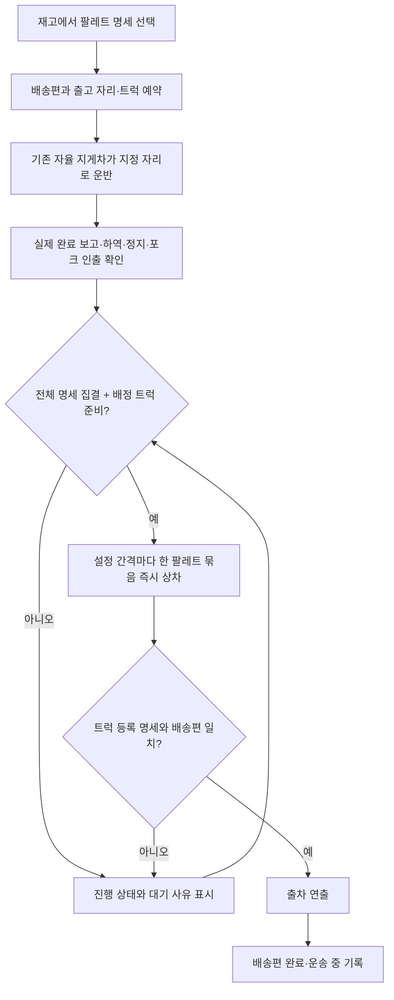

# 팔레트 배송편과 트럭 입출고

기준일: **2026-10-20**. 양방향 배송편·상하차를 현재 창고 맵에 적용했다. 최종 Editor 빌드, 저장 맵 재로드·전체 입고, 실제 지게차 운반과 예외 처리를 검증했다. 아래 검증 범위와 그래픽 검사 제한을 함께 확인한다.

이 문서는 배송편 명세, 입출고 인계 조건, 트럭 상하차와 출발을 담당한다. 화면 조작과 현재 외형은 [WAREHOUSE.md](WAREHOUSE.md), 외부 에셋 설치는 [TEAM_ASSETS.md](TEAM_ASSETS.md), 창고 자율 운반은 [AUTONOMY.md](AUTONOMY.md), 상품 생성은 [CARGO_RULES.md](CARGO_RULES.md)를 따른다.

## 구현 범위

| 구분 | 현재 코드의 범위 | 남은 계획 |
| --- | --- | --- |
| 배송편 | 실제 팔레트 명세, 구역 자리·트럭 예약, 준비·상하차·출발·완료 상태 | 외부 WMS/MES 연계, 영구 저장, 반송·부분 인수 정책 |
| 출고 | 기존 지게차로 출고 구역에 운반, 인계 확인, 트럭에 한 묶음씩 상차 | 상품명만으로 주문 생성, 낱개 피킹 |
| 입고 | 트럭 명세의 묶음을 입고 구역에 하나씩 하역, 기존 NPC 검수·랩 포장·랙 운반으로 연결 | 외부 도착 물량의 지속 생성, 거절·격리 인수 |
| 트럭 | 지정 도크 정차 확인, 적재 자리·허용 중량 검사, 설정된 경로를 따르는 출차 연출 | 실제 차량 동역학·안전 주행, 다음 차량 진입·후진 접안·자동 교대 |
| 운전기사 | 플레이어와 같은 기본 캐릭터가 운전석에 앉은 고정 자세, 트럭 이동에 동행 | 운전 AI·승하차·운전 애니메이션은 구현 대상 아님 |
| 문·도크 설비 | 현재 열린 적재함과 고정 연결판 사용 | 문 개폐·잠금, 연결판 철수, 차량 고정 장치와 출발 인터록 |

배송편은 입고·출고 방향과 사용할 구역·트럭을 가진다. 구역 이름, 도크 번호, 필요한 팔레트 수는 해당 데이터에서 읽으며 특정 예시 번호나 수량을 완료 조건으로 사용하지 않는다. 예제 맵의 초기 물량·차량 배치는 운영 알고리즘과 구분한다. 지게차를 입고·출고 전용으로 고정하지 않으며 기존 가용 차량 배정을 사용한다.

예제 트럭은 110×110cm 팔레트용 적재 자리6개를 두 열·세 줄로 구성한다. 자리의 검사 크기는111×111cm이고, 앞뒤 줄 중심 간격은115cm다. `configure_shipping_system.py`는 고정 도크 연결판의 실제 외곽을 트럭 좌표로 변환해 적재함 안으로 들어온 부분을 비운다. 첫 줄 중심은 연결판 끝과 바닥 뒤쪽 끝에서 각각57cm 이상 떨어뜨리고, 마지막 줄도 바닥 앞쪽 끝에서57cm 이상 떨어져야 구성을 허용한다. 연결판·트럭을 옮기거나 기존48개 상자의 모델·규격·품목·ID·질량을 바꾸지 않고, 기존6개 팔레트의 적재 위치만 맞춘다. 저장 맵 검사는 에디터와 PIE에서 이 팔레트·상자 전체가 고정 연결판과 실제로 겹치지 않는지도 확인한다.

## 출고 흐름

명세에는 팔레트 참조·식별명, 해당 팔레트의 실제 화물 구성, 지게차 작업 ID, 출고 대기 자리와 트럭 적재 자리를 기록한다. 동일 팔레트를 여러 배송편에 중복 예약하지 않고, 진행 중인 배송편들이 같은 구역 자리를 공유하지 않게 한다. 빈 팔레트·손상·랩 파손·손 운반·운송 중 물류와 수용량 부족은 오류로 반환한다.

출고 구역을 지나가는 것만으로 도착을 인정하지 않는다. 배송편에 연결된 **실제 지게차 완료 보고**가 있어야 하며, 팔레트가 지정 자리에 내려져 정지하고 바닥에 지지되어야 한다. 화물 구성이 예약 때와 같고 포크가 빠졌는지도 확인한다. 다른 배송편의 팔레트와 중복 등록은 준비 수량에 포함하지 않는다. 상차 전 물류가 다시 움직이거나 명세와 달라지면 준비 조건을 재검사한다.

**화물 준비와 트럭 준비는 별도 상태**다. 배정 트럭이 지정 도크에서 정지하고 부품·적재 공간이 유효하며 사용 가능한 상태여야 상차한다. 필요한 팔레트가 모두 집결하기 전에는 일부부터 상차하지 않는다. 상차를 시작하면 아직 출고 구역에 있는 명세와 이미 트럭에 실린 명세를 함께 추적한다.

상차 때 실제 묶음의 크기와 트럭 슬롯, 기존 적재물과의 겹침, 총 허용 중량을 검사한다. 모든 명세가 실린 뒤 트럭의 등록 명세와 배송편을 대조하고 출발한다. 출차 완료는 창고 출고 완료를 뜻하며 최종 고객에게 배송 완료된 것으로 처리하지 않는다.

## 입고 흐름

트럭의 초기 팔레트 명세를 확인한 뒤 관제에서 입고 구역을 지정해 하역을 시작한다. 초기 등록이 끝나지 않았거나 오류가 있으면 일부 명세만으로 작업을 시작하지 않는다.

1. 해당 트럭에 실제 등록된 팔레트 명세와 입고 구역 자리를 예약한다.
2. 도크의 트럭 준비와 입고 자리의 공간·받침을 확인한다.
3. 설정된 간격마다 팔레트와 그 화물을 통째로 입고 자리에 즉시 옮긴다.
4. 현장 물리를 복원하고 기존 입고 NPC 검수·랩 포장·랙 운반 흐름에 인계한다.
5. 이번 명세를 모두 하역하고 트럭에 남은 등록 물류가 없는지 확인한 뒤 출차한다.

입고 자리의 공간이 부족하면 대기하며 기존 화물을 삭제하거나 덮어쓰지 않는다. 하역한 물류가 랙에 보관될 때까지 트럭을 붙잡지 않는다. NPC 확정·랩 파손과 재검수 기준은 [창고의 입고 확정 안내](WAREHOUSE.md#npc-입고-확정과-랩-포장)를 따른다.

## 상하차 연출과 물리 경계

사용자 기준에 따라 **트럭 상하차는 물리 작업의 재현 대상에서 제외**한다. NPC가 작업 중이라는 상태를 표시하고, 한 작업 간격마다 팔레트와 그 위의 화물을 즉시 옮긴다. 작업자 이동·들기 애니메이션, 지게차의 트럭 진입, 적재 고정·주행 중 흔들림은 재현하지 않는다.

창고 안에서 지게차가 운반하고 인계하는 과정은 기존 Chaos 물리와 하중·손상·실제 포크 삽입을 유지한다. 트럭에 상차된 묶음은 연출용으로 물리 시뮬레이션을 끄고 상대 배치를 보존한다. 입고 구역에 하역하면 저장했던 물리·중력·충돌 설정과 포장 연결을 복원한다. 이것은 허용된 상하차 경계 처리이며 창고 운반 실패를 좌표 보정으로 숨기는 기능이 아니다.

화물을 복제하거나 새로 생성해 명세를 맞추지 않는다. 같은 팔레트·화물 액터의 위치와 운송 소속을 바꾸며 품목·ID·질량·손상 정보를 유지한다. 출차 연출이 끝난 차량과 출고 화물은 화면·충돌에서 제외하고 세션 운송 기록을 남긴다. 출차 경로는 실제 도로 교통·충돌 회피를 해석하는 경로가 아니다.

상하차 간격과 배송편 경과 시간은 시뮬레이션 시간으로 계산한다. 배속과 일시정지는 공통 [시뮬레이션 시간 기준](PHYSICS.md)을 따른다.

### 운전석 인물 연출

`WarehouseLogisticsTruck`은 기존 플레이어의 기본 전신 메시·재질을 사용해 운전기사 한 명을 표시한다. 팔다리 길이를 유지한 고정 착석 자세로 손은 핸들 쪽, 발은 페달 쪽에 둔다. `DriverSeatPose`는 트럭 로컬 좌표에서 골반의 위치·방향이며 `DriverSteeringWheelCentreCm`으로 손 목표를 조절한다. `DriverCharacterClass`를 비우면 현재 게임 모드의 플레이어 외형을 사용한다.

운전기사는 차량에 붙은 표시 메시다. 독립 Pawn·AI·질량·충돌·오버랩·내비게이션 영향이 없으며 트럭의 적재 한도나 화물 명세를 바꾸지 않는다. 재배치·회전·출차에는 차량과 함께 이동하고, 출차가 완료되면 숨겨진다. 신규 트럭 인스턴스도 같은 기본 구성을 사용하지만 다음 트럭의 자동 생성·교대 기능을 추가한 것은 아니다.

## 관제와 예외 처리

관제는 배송편별 팔레트 명세, 집결·상하차 상태, 화물/트럭 준비 여부, 대기·오류 사유와 경과 시간을 표시한다. 완료·취소된 기록은 해당 상태로 남기며 다른 배송편의 수량에 섞지 않는다.

| 상황 | 처리 기준 |
| --- | --- |
| 팔레트 중복, 다른 배송편 예약, 빈 명세 | 배송편 생성 거부 |
| 트럭·구역·자리 누락, 역할 불일치 | 오류 사유 표시, 작업 진행 차단 |
| 지게차 작업 진행 또는 사용 가능 차량 없음 | 기존 관제 흐름에 따라 대기 |
| 하역·포크 인출 미완료, 화물 구성 변경·손상 | 출고 인계 미확정, 상차 대기 |
| 트럭 위치·정지·부품 또는 초기 명세 오류 | 트럭 준비 미충족 |
| 입고 자리 점유, 트럭 크기·중량 한도 초과 | 해당 묶음 이송 중단, 사유 표시 |
| 명세 누락·오적재 | 완료·출발 차단 |
| 배송편 취소 | 상하차 시작 전이며 진행 중 운반이 없을 때 대기 예약 취소 |

사람·지게차·문·연결판·차량 고정 장치를 모두 확인하는 산업용 출발 안전 인터록은 현재 구현 범위가 아니다. 현재의 준비 검사와 출차 연출을 인증된 실제 상하차 안전 제어로 해석하지 않는다.

## 구현과 검증 진입점

| 파일 | 역할 |
| --- | --- |
| `Source/msc_vr/WarehouseShippingSystem.h/.cpp` | 배송편·명세·구역 자리 예약, 실제 작업 인계 확인, 양방향 진행·완료 |
| `Source/msc_vr/WarehouseLogisticsTruck.h/.cpp` | 초기 트럭 명세, 묶음 상태 저장·이송·복원, 적재 검사·출차 연출 |
| `Source/msc_vr/WarehouseComputer.cpp`, `WarehouseComputerUI.cpp` | 기존 지게차 작업 연결, 재고 예약, 다중 선택 배송편·입고 하역 화면 |
| `Scripts/configure_shipping_system.py` | 기존 트럭·화물·구역을 배송편 데이터에 연결하는 증분 맵 적용 |
| `Scripts/verify_shipping_workflow_pie.py` | 실제 지게차 인계와 양방향 상하차·명세·예외 조건 실행 검사 |
| `Scripts/verify_shipping_saved_map_pie.py` | 저장 맵의 원래 화물 보존·초기 트럭 명세·관제 화면·전체 하역과 재로드 검사 |
| `Scripts/verify_truck_driver_pie.py` | 기존/신규 트럭의 운전자 외형·착석·비충돌, 그룹 재배치·회전·출차, 외부/실내 캡처 |

### 2026-10-27 운전기사 검증 결과

Editor 빌드 후 `verify_truck_driver_pie.py`의 실제 PIE 검사를 통과했다. 근거는 `Saved/Logs/WarehouseVisualsSharedLift1_20261027.log`의 `TRUCK_DRIVER_PIE_PASSED`와 `Saved/Testing/TruckDriver/DriverReport.json`이다.

- 저장 맵의 트럭3대와 신규/교체용 인스턴스2대가 같은 플레이어 메시로 착석하고, 운전자 표시가 물리 접촉·오버랩·주요 탐색 채널을 막지 않음을 확인했다.
- 공개 배치 기능으로 그룹 이동·좌우90도 회전·원위치 복원을 실행해 운전자가 차량을 따라가고, 표시 설정을 바꿔도 화물 명세·질량이 유지됨을 확인했다.
- 격리된 시험 차량의 출차에서 운전자가 함께 이동하다 출차 완료 후 숨겨지고, 다른 차량의 운전자는 계속 표시됨을 확인했다.
- `Saved/Testing/TruckDriver/DriverExterior.png`, `DriverInterior.png`의1440×1000 캡처에서 창유리 너머 운전석의 착석 인물을 확인했다. 원래 유리 재질을 변경할 필요는 없었다.

검사는 실제 게임 API를 호출했으며 OS 키보드·마우스 입력 검사는 아니다. 기존 창고 맵은 저장하지 않았고 신규 트럭의 자동 진입·교대나 실제 운전 AI를 검증한 결과가 아니다.

### 2026-10-20 확인 결과

| 근거 | 실제 확인 범위 |
| --- | --- |
| `Saved/Logs/ShippingBuild7_20261020.log` | 최종 `msc_vrEditor Win64 Development` 빌드 성공 |
| `Saved/Logs/ShippingSavedReloadPIE_20261020.log`, `Saved/Testing/ShippingSavedMap/NullRHIReport.json` | 새 프로세스에서 저장된 `Lvl_FirstPerson`을 재로드. 원래 48개 상자의 ID·전체 상품 생성 데이터·질량·모델·크기 보존, 초기 6팔레트 × 8상자, 도크 3곳과 두 구역의 각 6자리 확인. 전량을 한 묶음씩 입고 구역으로 하역하고 원래 물리 복원·빈 트럭 출차 완료. 트럭 적재 총량은 팔레트 포함 약279.95kg |
| 같은 로그의 최종 `SHIPPING_WORKFLOW_PIE_PASSED`, `Saved/Testing/ShippingWorkflow/Report.json` | 저장 리그·랙을 복사한 미저장 Entry에서 지게차의 실제 출고 운반 2건과 입고 후 랙 보관 1건. 실제 포크 삽입·승강·주행·하역·인출 보고, 전량 집결/배정 도크 대기, 적재 크기·중량 초과 거부, 순차 상하차·명세 일치·출발·경과 시간, 입고 자리 점유, NPC 확정·랩 포장 확인 |
| 같은 운반 검사 | 중복 팔레트·배송편 예약 거부, 구역을 지나가는 것만으로 인계되지 않음, 팔레트 삭제와 대기 자리 삭제/복원, 관제 컴퓨터 손상·삭제 시 실제 운반 큐와 예약 유지, 컴퓨터 교체 후 정상 취소 확인 |
| `Saved/Logs/ShippingSavedMapPIE4_20261020.log`, `Saved/Testing/ShippingSavedMap/UIScreen.png` | RenderOffscreen의 별도 플레이 창에서 1600×900 관제 화면을 확인. E에 연결된 상호작용 함수를 호출해 화면 전환·실시간 갱신·입력 잠금·플레이어 복귀 확인. OS 키보드 입력 검사는 아님 |

운반 검사는 지게차의 자세·속도·AI 상태·완료 ID를 강제로 바꾸지 않았다. 트럭의 묶음 이송은 허용된 연출 API를 사용했다. 저장 맵의 재고/UI 검사에서는 자동 지게차 배정과 유휴 이동만 잠시 껐고, 저장 전 원래 설정을 복원했다. 실제 운반은 별도 Entry 검사에서 실행했다.

전체 맵의 원래 그래픽 옵션에서는 GPU 장치 제거 오류가 발생했다. 화면 검사는 해당 실행에만 레이 트레이싱·Lumen·가상 그림자·Nanite를 끄고 수행했으며 프로젝트 그래픽 설정은 변경하지 않았다. 최종 저장 맵 재로드와 운반 회귀 검사는 NullRHI로 렌더링 없이 실행했다. 이는 원래 그래픽 옵션의 안정성이나 창고 전체의 모든 배치를 검증한 결과는 아니다.

초기 화면 검사 중 저장 함수가 Slate 검사를 재진입시켜 저장 성공/실패 기록이 섞였다. 검사에 재진입 방지를 추가했고, 저장 결과의 최종 근거는 새 프로세스의 `NullRHIReport.json`이다. 같은 최종 로그의 앞선 Python 생성 API 오류도 수정 후 재실행했으며, 마지막 성공 표시와 최신 보고서를 기준으로 한다.

## 남은 계획

- 외부 방문 대기열, 공유 진출입 경로 예약, 다음 트럭의 경계 밖 생성·진입·후진 접안·자동 교대.
- 문 개폐·잠금, 연결판·주차 브레이크·차량 고정 장치와 사람/포크 잔류를 포함한 출발 인터록.
- 실제 트럭 주행·제동·타이어·현가·축하중·화물 고정과 주행 중 이탈.
- 반송·부분 인수·격리, 외부 WMS/MES 주문과 영구 재고·운송 기록.

이 계획들은 현재의 한 묶음씩 즉시 상하차하는 연출에 자동으로 포함되지 않는다. 추가할 때는 창고 운반 물리와 트럭 연출의 경계를 먼저 정한다.
